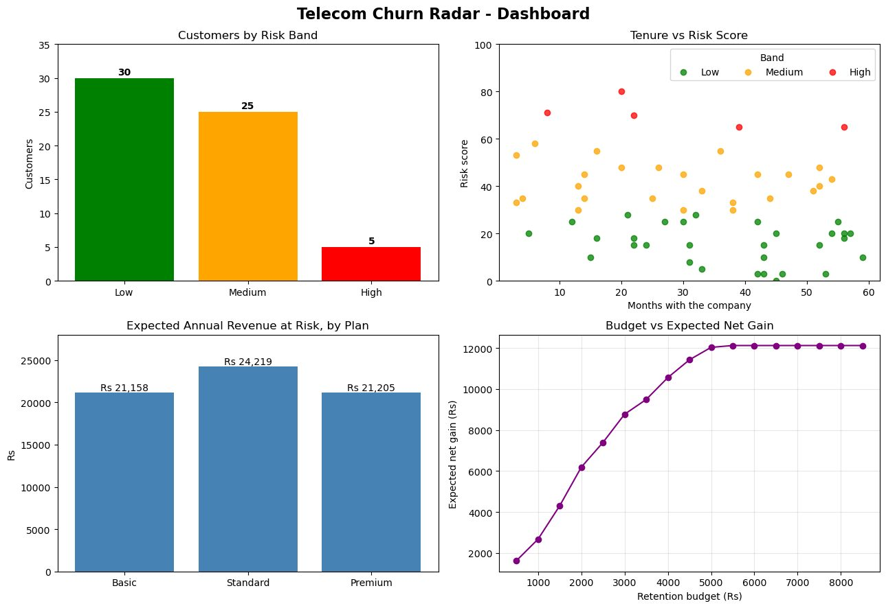

# Telecom Churn Radar

**Tool:** Python

Scores 60 simulated customers of a telecom operator on churn risk from usage, complaints, tenure, payments and recharge gaps, then matches each to a retention offer.

## Highlights
- 30 / 25 / 5 customers in low, medium and high risk
- Rs 66,581 expected annual revenue at risk (31.3% of the total)
- Budget planner: Rs 3,000 reaches 12 customers for an expected net gain of Rs 8,769

## Files
- `Telecom.ipynb`

Customer data is randomly simulated inside the notebook, so no dataset is needed.

## How to open
Open `Telecom.ipynb` in Jupyter or Google Colab and run all cells. Needs Python 3 and matplotlib.

---
By Faaz Mistry · [LinkedIn](https://www.linkedin.com/in/faaz-mistry-369a11246/) · faazmistry110@gmail.com
